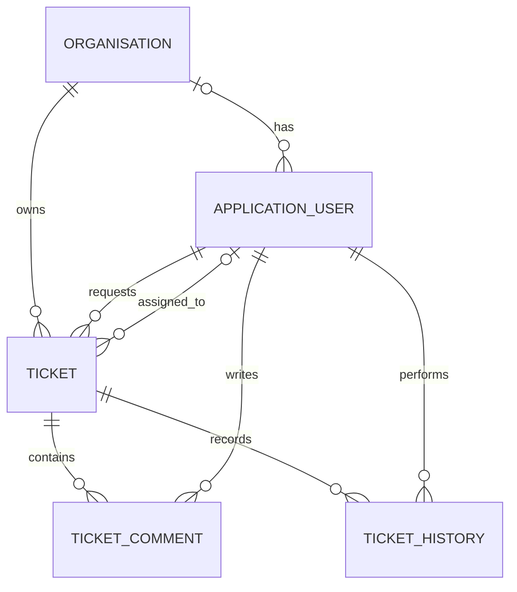

# ResolveHub – Initial Entity Relationship Diagram

## 1. Overview

This document describes the initial logical data model for
the ResolveHub Customer Support and Service Request Management Platform.

The model contains five core entities:

- Organisation
- ApplicationUser
- Ticket
- TicketComment
- TicketHistory

## 2. Entity Relationship Diagram

## 3. Relationship descriptions

| Relationship | Cardinality |
|---|---|
| Organisation to ApplicationUser | One-to-many |
| Organisation to Ticket | One-to-many |
| ApplicationUser to requested Ticket | One-to-many |
| ApplicationUser to assigned Ticket | One-to-many; assignment is optional |
| Ticket to TicketComment | One-to-many |
| ApplicationUser to TicketComment | One-to-many |
| Ticket to TicketHistory | One-to-many |
| ApplicationUser to TicketHistory | One-to-many |

## 4. Primary and foreign keys

All five entities use GUID primary keys.

Foreign-key relationships:

- ApplicationUser.OrganisationId references Organisation.Id.
- Ticket.OrganisationId references Organisation.Id.
- Ticket.RequesterId references ApplicationUser.Id.
- Ticket.AssigneeId references ApplicationUser.Id.
- TicketComment.TicketId references Ticket.Id.
- TicketComment.AuthorId references ApplicationUser.Id.
- TicketHistory.TicketId references Ticket.Id.
- TicketHistory.ActorId references ApplicationUser.Id.

Ticket.Reference has a unique database index.

## 5. Delete behaviour

The initial EF Core configurations use restrictive delete behaviour.

This prevents accidental cascading deletion of:

- Ticket history records.
- Ticket comments.
- Referenced users.
- Organisations associated with existing records.

The database uses SQL Server NO ACTION behaviour for these foreign keys.

Additional application-level audit protection is required to prevent unauthorised modification of audit records.

## 6. Business rules and assumptions

1. Each user is provisionally associated with at most one organisation.
2. Internal users may have no customer OrganisationId.
3. A ticket must have a requester and organisation.
4. A ticket may remain unassigned until allocated to an agent.
5. Customers can access customer-visible comments but not internal notes.
6. Ticket history records identify the user responsible for an event.
7. Ticket references must be unique.
8. GUID identifiers are used for all five entities.

## 7. Outstanding design decisions

- OQ-01: Confirm whether a user may belong to multiple organisations.
- Confirm the final role and permission matrix.
- Confirm whether email uniqueness is global or organisation-specific.
- Confirm category and priority configuration requirements.
- Confirm retention and archival rules for tickets and audit records.

Note: Category is currently represented as a string and priority as an enum. Administrator-managed configuration may require additional lookup entities in a subsequent design iteration.

## 8. Database implementation

Database: ResolveHubDb

Database engine: SQL Server LocalDB

ORM: Entity Framework Core 10

Migration history:

- InitialCreate
- AddCoreDomainEntities

The database schema is managed using Entity Framework Core migrations.
